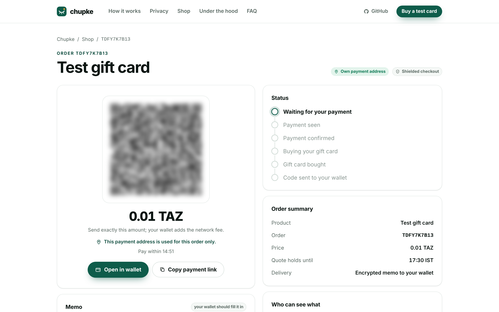
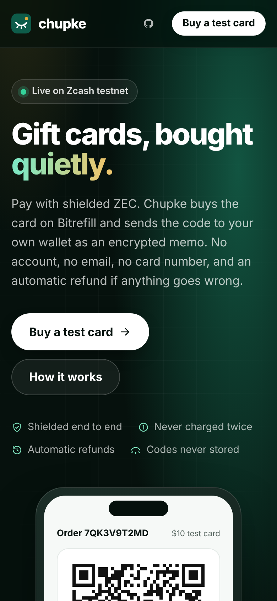
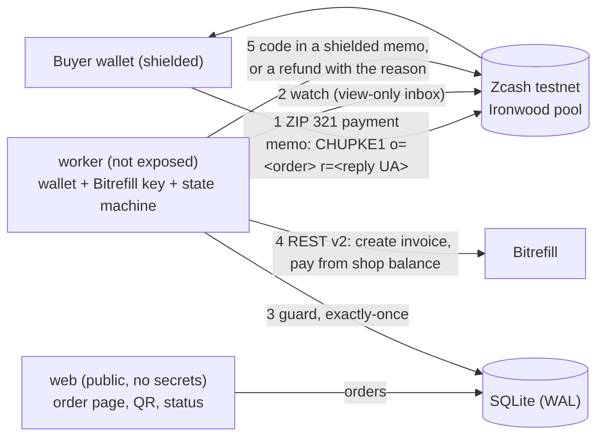

# Chupke

> **Pay shielded ZEC from your Zcash wallet and get a gift card code delivered to your encrypted memo inbox:
> no account, no email, automatic refund if anything fails, never charged twice.**

*Chupke* (चुपके) is Hindi for "quietly". It was built in one day for the Free Society Hack (Zcash × Bitrefill), Mumbai,
4 Nov 2026, on Zcash testnet (NU7) and Bitrefill REST v2 plus the Bitrefill MCP.

[](https://github.com/bilgin-kocak/chupke/actions/workflows/ci.yml)

**[▶ Watch the demo (1:31)](https://youtu.be/UON-xeeoFoY)** · **[Try it live](https://chupke-production.up.railway.app)** (Zcash testnet) ·
**[Privacy design](PRIVACY.md)** · **[Testnet evidence](docs/EVIDENCE.md)** · **[Bitrefill feedback](FEEDBACK.md)**


## In one minute

- **What it is:** a private checkout for gift cards.
  1. The buyer pays shielded ZEC from any Zcash wallet.
  2. An autonomous agent buys the card on Bitrefill from the shop's own balance.
  3. The agent sends the code to the buyer's wallet as an encrypted memo. No account, no email, no card number.
- **Why it's different:** money only moves under rules the code enforces.
  - An allowlist and caps of $10 per order and $30 a day.
  - Each payment is processed once and each order bought at most once, even across crashes and rescans.
  - Every failure path refunds automatically, with the reason in the memo.
- **Proof:** it runs live, and the [demo](https://youtu.be/UON-xeeoFoY) shows a real order on the public app:
  - a shielded payment (`130c2799…`)
  - the agent's Bitrefill purchase
  - the code arriving in the buyer's wallet about a minute later

  Everything is on Zcash testnet with Bitrefill's free test products, and every claim below links to its evidence.
- **Built with:** TypeScript, zingo-cli, ZIP 321, ZIP 316, Bitrefill REST v2 and MCP, SQLite, Docker and Railway.
  97 tests, CI green.

**Contents:** [For judges](#for-judges) · [How it works](#how-it-works) · [Guarantees](#guarantees-and-how-each-is-proven) ·
[Privacy](#privacy-at-a-glance) · [Evidence](#evidence-testnet-4-nov-2026) · [Run it](#run-it-in-under-15-minutes) ·
[Design decisions](#technology-and-design-decisions) · [Bitrefill](#bitrefill-touchpoints) · [Next](#next-milestone-30-days)

## For judges

| Track requirement | Where to see it |
| --- | --- |
| **Zcash flow** (shielded payment, delivery and refund) | Demo [0:27–0:50](https://youtu.be/UON-xeeoFoY?t=27). The payment `130c2799…7efa` and the delivery memo `e6570b46…` are on testnet, listed under [Evidence](#evidence-testnet-4-nov-2026). |
| **The agent makes a purchase** | Demo [0:37](https://youtu.be/UON-xeeoFoY?t=37): the order page moves on its own from *Payment seen* to *Code sent*. The engine is in [`src/engine/`](src/engine/), and every Bitrefill call is in [`src/bitrefill/client.ts`](src/bitrefill/client.ts). |
| **Privacy: who sees what, and the gaps** | [Privacy at a glance](#privacy-at-a-glance) and [PRIVACY.md](PRIVACY.md). |
| **Themes: private payment rails, privacy beyond the transaction** | ZIP 321 shielded checkout, refunds and delivery over memos. Each order gets its own diversified address. No accounts, codes are never stored, reply addresses are purged after an hour, and the public server holds no keys. |
| **Public URL** | https://chupke-production.up.railway.app: shop, order pages and live status. The stats strip shows the deployment's real numbers. |
| **Bitrefill feedback** | [FEEDBACK.md](FEEDBACK.md): what worked, what didn't, and a dated log of live findings. |
| **It doesn't break** | [Guarantees](#guarantees-and-how-each-is-proven), each tied to a live run. Among them, a `kill -9` of the agent mid-delivery still sent exactly one code. |

## How it works

| Order, waiting (its own address) | Order, delivered | Order, refunded | Operator dashboard | Phone |
| --- | --- | --- | --- | --- |
|  |  |  |  |  |



1. The buyer picks a product and pastes a fresh shielded reply address (`utest1…`). Its Bech32m checksum is verified,
   so typos are caught before any money moves.
2. The page shows a ZIP 321 QR with the TAZ price, the memo `CHUPKE1 o=<orderId> r=<replyUA>`, and the order's own
   shop address. That's a fresh diversified address no other order gets, or the shop's main address if none is ready.
   The memo also has a copy button.
3. The buyer pays from any testnet wallet.
4. The worker sees the payment and waits for confirmation. In split mode, which the live app runs, a view-only inbox
   made from the shop's viewing key does the watching. It runs the guard (allowlist and caps), buys on Bitrefill, then
   waits until every Bitrefill order says `delivered`.
5. The worker sends the code to the reply address as a shielded memo:
   `Chupke #<order> delivered` / label / `Code: …` / `PIN: …` / `Redeem: …`. The order page never shows it.
6. On any failure the worker sends a shielded refund of the full amount. The memo carries the reason and a `ref <txid8>` tag.
7. If the buyer paid more than the price, the excess comes back after delivery:
   `Chupke #<order> overpayment: … TAZ returned.` An excess under 20,000 zat isn't worth a network fee and is kept.

**The lane.** This is Lane 5 ("Private by default"). It also carries Lane 1's guarantee (bounded, exactly-once spending
with refunds) and Lane 2's ending (delivery in the buyer's own encrypted inbox).

**Merchant of record.** The buyer's ZEC pays Chupke; Chupke pays Bitrefill from its own Bitrefill balance. The demo buys
Bitrefill's free test products, so that balance is never drawn. In production it would be funded by converting ZEC
revenue to USDC in batches. Bitrefill never receives or accepts ZEC here.

## Guarantees, and how each is proven

| Guarantee | How it's enforced | Proven by |
| --- | --- | --- |
| **Each payment is processed once** | Every received output is inserted once (`INSERT OR IGNORE` on `txid:pool:index`) | A full rescan re-saw every payment and bought nothing new ([NOTES](docs/NOTES.md)). Invariant test 1 in [`test/engine.test.ts`](test/engine.test.ts). |
| **Each order is bought at most once** | `fulfillments.order_id` is a primary key; a second payment for an order is refunded | Duplicate payment on YMXHFE23J6, refunded in `34f0a31a…`. Invariant test 2. |
| **No money moves twice after a crash** | State is committed before every money-moving call. On resume the worker looks before acting: it checks the invoice before paying again, and searches its own sent memos (after a 3-minute guard) before resending. If it can't look, it holds for review. | `kill -9` of the worker 40 ms into a delivery send. After restart: one Bitrefill invoice, one delivery memo (Q5S258G7D0, `cede8cd2…`). Invariant tests 3, 4, 7 and 7b. |
| **Every failure refunds, with the reason** | Refund paths for underpaid, over the cap, card failed, quote expired, duplicate, and real purchases switched off | Six live refunds, including WHD2NBHECQ on the public app today. Invariant tests 6 and 8. |
| **Spending is bounded** | Allowlist, $10 per order, $30 a day. Nobody approves exceptions; anything outside the rules is refused and refunded. | N3RVZ44M5G ($20 card) refused and refunded. Guard tests. |
| **Codes are never stored** | Fetched at send time, held in memory, written straight into the encrypted memo. Stripped from Bitrefill invoice responses at parse time. | Invariant test 9, plus the redemption and log-scrubbing tests. Log scans after every live run found 0 codes, addresses or memos. |
| **The public server can't spend or see keys** | The web holds no wallet, viewing key or Bitrefill key. The worker derives per-order addresses. In Docker the web gets no `.env`. | `docker-compose.yml`, and the container run in [NOTES](docs/NOTES.md) |

## Privacy at a glance

| Who | Sees | Never sees |
| --- | --- | --- |
| Anyone watching the chain | That shielded transactions happened, and their fees | Who paid whom, the amount, or the memo |
| The light-wallet server | The worker's IP address and when it syncs | The buyer's IP, any address, or the memo |
| The web server and its host | The buyer's IP and page visits, and the reply address until 1 hour after the order ends | Wallet keys, or the code |
| The shop operator | The order, the amount, and the reply address until it's purged | The buyer's keys. The code is never stored. |
| Bitrefill | That the shop bought this card from its own balance | Who the buyer is, their wallet, IP or payment |

**Gaps, named on purpose:**
- **Custody.** The operator holds the buyer's money for the minute between payment and delivery. The guarantee is
  operational (caps, exactly-once, refunds), not trustless escrow.
- **Confirmations.** Payments are accepted after 1 confirmation.
- **No Nym in the demo build.** The `:nym` image is built in CI but not yet run against the mixnet.
- **Re-readable codes.** The operator could re-read a delivered code through the shop's outgoing viewing key.

The full design, and what we'd fix next, is in [PRIVACY.md](PRIVACY.md).

## Evidence (testnet, 4 Nov 2026)

These are all real transactions. The full list is in [docs/EVIDENCE.md](docs/EVIDENCE.md), regenerated with
`npx tsx scripts/evidence.ts`, and the runs are written up in [docs/NOTES.md](docs/NOTES.md).

| what | order | txid / id |
| --- | --- | --- |
| **live app, in the demo video:** payment, then the code by memo | MBZ6TXKA3Y | [`130c2799…7efa`](https://testnet.zcashexplorer.app/transactions/130c2799ec8f7a7769836ccadc85b5ec885de1f1711fad133e4649e0729c7efa), [`e6570b46…b21e`](https://testnet.zcashexplorer.app/transactions/e6570b464161d09c4940f2223d31c688f7453af95a4653371a0c169ca249b21e) |
| **live app, in the demo video:** the card failed, refunded automatically | WHD2NBHECQ | [`c581517b…f8f5`](https://testnet.zcashexplorer.app/transactions/c581517bed2ef1baf5052b9961f21df4242904673baf28c0b246c0a3a9b9f8f5), [`c7d2d28f…2442`](https://testnet.zcashexplorer.app/transactions/c7d2d28faa044fc71ce3b5a365f9b730642df68b16831ea83f872c2019ea2442) |
| payment (0.01 TAZ, `CHUPKE1` memo) | YMXHFE23J6 | [`8324da93…902d`](https://testnet.zcashexplorer.app/transactions/8324da93e32da346653d98c72904a720ed3eb3470931ccac0ac49ebbd17c902d) |
| Bitrefill invoice (test product, delivered) | YMXHFE23J6 | `0dbb77e0-3573-48bd-abd1-39a6e57b5caf` |
| delivery memo with the code | YMXHFE23J6 | [`433da696…f576`](https://testnet.zcashexplorer.app/transactions/433da69605a37eec4f9a72ab678602aa5a7f59bd80ca590374b0808d0ba0f576) |
| refund: underpaid | SQMXQ5C4Q6 | [`f2a9b0a8…e04d`](https://testnet.zcashexplorer.app/transactions/f2a9b0a85a7331e881cb879b77fccee7a3686594875759a7aac2f97a3eb9e04d) |
| refund: over the per-order cap | N3RVZ44M5G | [`a1bbe272…8932`](https://testnet.zcashexplorer.app/transactions/a1bbe272901868c7824886963cd9c3d4acb2aa6d641efd23ef53f7287cea8932) |
| refund: the Bitrefill order failed | KXYYT4NGG8 | [`4c9f9879…eb79`](https://testnet.zcashexplorer.app/transactions/4c9f9879779c53887ac0d6a9002878f48cec9413175796edfdff78d817d1eb79) |
| refund: duplicate payment | YMXHFE23J6 | [`34f0a31a…92d8`](https://testnet.zcashexplorer.app/transactions/34f0a31ac141357661471ddc9111bcedf2cdd076b50e59792f0b05dcad1a92d8) |
| refund: quote expired | CVTJ3622GM | [`4e45c0c2…13cb`](https://testnet.zcashexplorer.app/transactions/4e45c0c2a676c5e516ba21352d2ac08a90c2a206c3efdec2330faa75488413cb) |
| crash test: `kill -9` mid-delivery, still exactly one code | Q5S258G7D0 | [`cede8cd2…9c85`](https://testnet.zcashexplorer.app/transactions/cede8cd298d0fb7390d60d644080789664f6e487e7ac6fefcec4ea84658a9c85), invoice `63020bd6-c553-4e3a-b8c8-cd6914d7e746` |
| split-mode delivery (view-only inbox watched, outbox sent) | 3J5T3XDWPH | [`6b8d1f3f…5f7d`](https://testnet.zcashexplorer.app/transactions/6b8d1f3f8ccf9990040d7ae18ed6a9daf6e41e6bd6b1764ab57f674c5f555f7d) |
| overpayment returned after delivery (paid 0.015, price 0.01) | VTQ8KA58D0 | [`287e7afd…b532`](https://testnet.zcashexplorer.app/transactions/287e7afd27e258ed7e570a31d74d9cadd753a49a810289e886eda4a73729b532) |
| final CI image as containers: own-address payment, then delivery | NS0Y84VNJD | [`7322bacd…cbcd`](https://testnet.zcashexplorer.app/transactions/7322bacd28477c93a43f634c2968d6cca9715c99afa9246a1743512f0a3fcbcd), [`4dedd1b9…ec2f`](https://testnet.zcashexplorer.app/transactions/4dedd1b9e913bf1d0b798a5cee03ed340b42e323b84de3bc9805847c2d44ec2f) |
| payment to the order's own diversified address, then delivery (split mode) | Y94QVCAHVB | [`5204d07d…f38e`](https://testnet.zcashexplorer.app/transactions/5204d07dca328fda8bd5fe1cbd773dd0896579b17d4fa86b7c62b711d9fdf38e), [`cc7c9429…ca8f`](https://testnet.zcashexplorer.app/transactions/cc7c9429a396a1c979dedc54817d6b94740a7c2d940de69c2190f86d6d1fca8f) |

**Bitrefill purchases use Bitrefill's free test products.** Every invoice above is a real REST v2 invoice, created,
paid from the shop balance, and delivered or failed. No real-money gift card was bought: the shop's Bitrefill balance
is 0, and none was needed for the demo. The real-product path is built and guarded:
- Google Play India ₹100 ($1.14) was proposed by the MCP catalog and approved into the allowlist.
- Ordering it is refused and refunded automatically ("Shop isn't selling this yet") while `ALLOW_REAL_PURCHASES=false`.
- Enabling it takes Bitrefill balance and one setting.

**Demo video:** [youtu.be/UON-xeeoFoY](https://youtu.be/UON-xeeoFoY) (1:31), a real order on the live app, built in
[video/](video/README.md). **Public URL:** https://chupke-production.up.railway.app (testnet, on Railway;
[docs/DEPLOY.md](docs/DEPLOY.md)).

## Run it in under 15 minutes

```bash
git clone https://github.com/bilgin-kocak/chupke && cd chupke
```

```bash
cp .env.example .env   # then fill in BITREFILL_API_KEY, ZINGO_SEED, WALLET_BIRTHDAY, DASHBOARD_PASSWORD
```

```bash
docker compose up --build
```

- The first build compiles zingo-cli from a pinned zingolib commit, which takes about 5–15 minutes. To skip the
  compile, use the image CI publishes: `docker compose pull && docker compose up -d`.
- For a public URL, add `--profile tls` (Caddy, automatic HTTPS for `DOMAIN`) or `--profile tunnel` (a Cloudflare
  quick tunnel). [docs/DEPLOY.md](docs/DEPLOY.md) has the full steps, including Railway (one service, both
  processes, `scripts/railway-start.ts`).
- The web listens on :8080. The worker restores the shop wallet from `ZINGO_SEED` on first start; remove the seed from
  `.env` afterwards. Set `WALLET_MODE=split` to watch with a view-only inbox.
- `GET /dashboard` uses basic auth (`chupke` / `DASHBOARD_PASSWORD`).
- `CHUPKE_IMAGE=ghcr.io/bilgin-kocak/chupke:nym` in `.env` selects the Nym build, which sends transactions over the
  mixnet. It's built in CI but not yet run against the mixnet ([docs/DEPLOY.md](docs/DEPLOY.md), step 6).
- Without Docker: `npm ci`, `scripts/build-zingo.sh`, `npm run worker`, then `npm run web`.

The demo payer can be any testnet wallet, or the CLI buyer wallet: `npm run buyer:pay -- --order <id>` and
`npm run buyer:inbox`.

## Technology and design decisions

- **Two processes, one SQLite file (WAL).** The **web** is public and holds no secrets: it has the allowlist, the public
  shop address and the database. The **worker** isn't exposed and holds the wallet, the Bitrefill key and the state machine.
  In Docker the web gets no `.env` and never mounts the wallets volume.
- **Node 22, TypeScript (strict), tsx, Hono.**
  - Server-rendered HTML with one inline CSS block, following [DESIGN.md](DESIGN.md).
  - No third-party scripts, fonts or CDNs, a strict CSP, `no-referrer`, and no request logging.
  - **better-sqlite3**, **zod** (env and every external response), **pino** (path redaction plus address scrubbing),
    **qrcode** (server-side SVG), and **vitest** (97 tests; fakes only in tests).
- **Zcash via zingo-cli**, behind a `ZcashWallet` adapter.
  - Calls are one-shot and serialized per wallet directory, by an in-process queue plus a cross-process lock file. The
    lock file also tracks the zingo-cli child process, so an orphaned child of a killed worker is waited for.
  - Each call has a 120 s timeout and zod-parsed stdout. Logs carry only the command, exit code and duration.

  Findings are in [docs/WALLET.md](docs/WALLET.md):
  - zingo-cli 0.5.0 forces every send over the Nym mixnet in its default build, so the demo image builds with
    `nakednet-test-mode`. CI also publishes `ghcr.io/bilgin-kocak/chupke:nym`, the upstream mixnet build plus
    `nym-proxy` ([docs/DEPLOY.md](docs/DEPLOY.md), step 6). It compiles, but it hasn't been run here, because the
    build sandbox can't reach the mixnet.
  - `--waitsync` only works for wallets created with it.
  - Errors at the proposal stage are recognized and retried quickly, and so is the Nym build's refusal to go online.
  - A one-function patch adds an opt-in extra TLS root, for egress proxies that re-terminate TLS.
- **Bitrefill REST v2 client.**
  - A sliding-window limiter allows 55 requests per 10 min, with separate windows for product endpoints and `/ping`.
  - GETs retry on 429 (honoring `Retry-After`, with jitter), on 5xx and on network errors. Money-moving POSTs never
    retry. The 429 path was checked against the live API.
  - Invoices are polled at most every 8 s. Done means *every* order says `delivered`.
  - `redemption_info` is normalized whether it comes as a string or an object, and stripped from invoice responses
    so codes never sit on invoice objects.
- **Per-order diversified addresses ([ZIP 316](https://zips.z.cash/zip-0316)).**
  - The worker keeps 10 fresh addresses ready (`zingo-cli new_address o`, an Orchard receiver only). In split mode
    the view-only inbox derives them; it gives the same address at each index as the spending wallet.
  - The web holds no keys, so it can't derive addresses. It hands each order the lowest free one, once, and falls back
    to the shop's primary address if the pool is empty. An address made by a different shop wallet is never shown.
  - All of them share the shop's viewing key, so the inbox receives payments to any of them. Payments are still
    matched to orders by memo: zingo-cli 0.5.0 doesn't report which address a note was paid to.
- **Privacy defaults.**
  - Reply addresses are purged 60 minutes after an order ends.
  - Codes are fetched at send time, held in memory and never stored.
  - Status pages and the API carry no addresses or codes, and the dashboard masks addresses to 8 characters.

  Full details are in [PRIVACY.md](PRIVACY.md).
- **Test products are free, so they don't count toward the daily cap** (`DAILY_CAP_INCLUDES_TEST=false`).
  The caps guard real spend. A `$20` test card on the shop page demonstrates the per-order refusal.

## Bitrefill touchpoints

- **What Chupke uses:**
  - **REST v2**: `/ping`, `/accounts/balance`, `/products/search`, `/products/{id}`, `POST /invoices` with
    `payment_method: "balance"` and `auto_pay: false`, `POST /invoices/{id}/pay`, `GET /invoices/{id}`, and `GET /orders/{id}`.
  - **Bitrefill test products** (`test-gift-card-code`, `test-gift-card-code-fail`).
  - **The Docs `llms.txt` index**, which the coding agent read while building, alongside the Quickstart, Test products
    and API reference pages.
- **Built today:** the client, the limiter, the state machine and the failure handling.
- **Reused:** nothing beyond the public API and docs.
- **Live findings** fed back in [FEEDBACK.md](FEEDBACK.md):
  - undocumented failure states (`all_error`, `permanent_failure`), which the live refund suite caught
  - codes embedded in invoice responses
  - an unlabeled BTC price unit
- **Hosted MCP server** (`https://api.bitrefill.com/mcp`): `scripts/mcp-catalog.ts` calls only the read tools,
  `search-products` and `get-product-details` with `currency: USD`.
  1. It finds code-only gift cards and their real USD prices.
  2. It checks each `package_id` against REST v2.
  3. It writes proposals within the per-order cap to `config/allowlist.proposed.json`.
  4. A human approves one with `--approve <sku>`.

  Using the two surfaces together means MCP does discovery and pricing while REST does the exact, guarded purchase.

## Next milestone (30 days)

- **Weeks 1–2: a Bitrefill partner/reseller pilot on mainnet.** Real cards behind the same caps, with the shop balance
  funded by batched ZEC → USDC top-ups
  ([Resell Bitrefill products](https://docs.bitrefill.com/docs/integration-flow.md),
  [fund the account balance](https://docs.bitrefill.com/docs/account-deposits.md)).
- **Week 2: Nym for wallet traffic.** Run the `:nym` image, which CI already builds, on a host where the mixnet is
  reachable, and measure the delivery time against today's ~60 s ([zingolib](https://github.com/zingolabs/zingolib)).
- **Week 3: match payments by receiving address as well as memo,** once zingo-cli reports which address a note was paid to.
  zingolib's note summaries carry a TODO for the address index. A payment that lost its memo could then still be
  tied to its order.
- **Week 4: open-source the shielded checkout and refund module** as a package: ZIP 321 requests, memo formats, the
  exactly-once engine and the zingo-cli adapter ([ZIP 321](https://zips.z.cash/zip-0321)).

## Repository map

| Path | What |
| --- | --- |
| `src/engine/` | The agent: guard (caps, allowlist), routing, fulfillment, refunds, the tick loop |
| `src/bitrefill/` | REST v2 client, rate limiter, redemption parsing |
| `src/zcash/` | Wallet interface, zingo-cli adapter, memos, ZIP 321, address checks |
| `src/db/` | SQLite schema and store (payments, fulfillments, address pool, events) |
| `src/web/` | Server, pages and theme ([DESIGN.md](DESIGN.md)), QR |
| `src/worker.ts` | The worker process |
| `scripts/` | zingo-cli build, smoke tests, buy-once, `find-products`, the MCP catalog, buyer pay/inbox, refund suite, rescan, evidence table, Railway start |
| `test/` | The vitest suite (97 tests) |
| `video/` | The demo video's source: Remotion scenes, ElevenLabs voice, a synthesized soundtrack, live captures ([video/README.md](video/README.md)) |
| `docs/` | [WALLET.md](docs/WALLET.md) (Zcash tooling), [NOTES.md](docs/NOTES.md) (live runs and decisions), [EVIDENCE.md](docs/EVIDENCE.md), [DEPLOY.md](docs/DEPLOY.md), [DEMO.md](docs/DEMO.md) |
