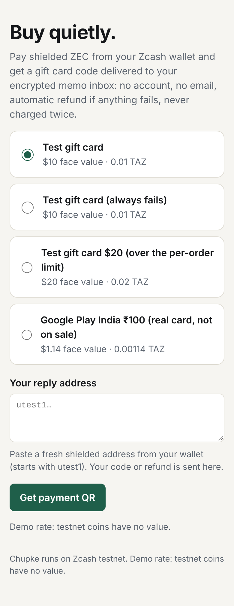
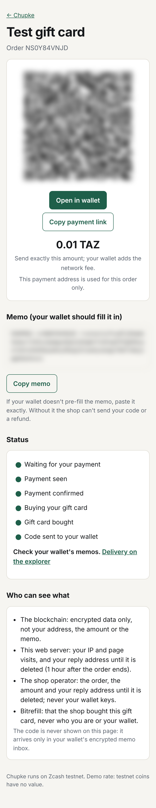
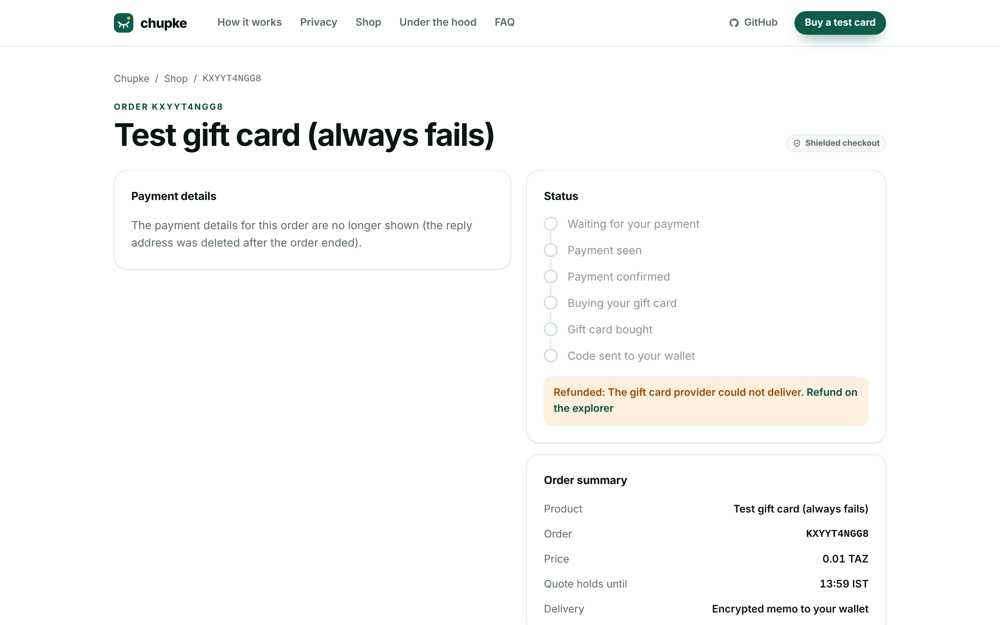
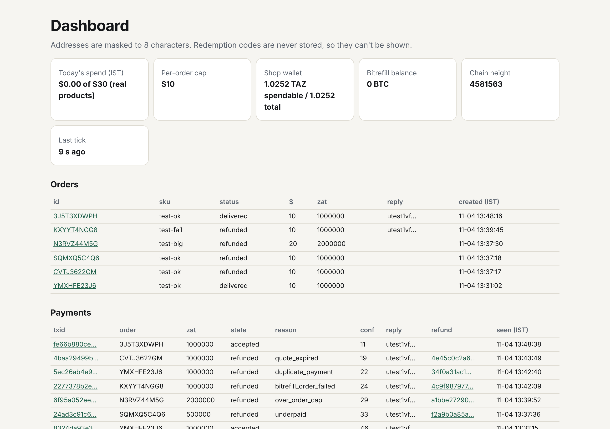
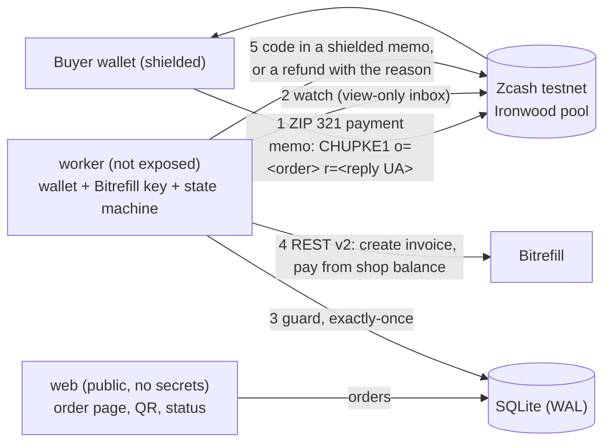

# Chupke

> **Pay shielded ZEC from your Zcash wallet and get a gift card code delivered to your encrypted memo inbox:
> no account, no email, automatic refund if anything fails, never charged twice.**

*Chupke* (चुपके) is Hindi for "quietly". It was built in one day for the Free Society Hack (Zcash × Bitrefill), Mumbai,
4 Nov 2026, on Zcash testnet (NU7) and Bitrefill REST v2 plus the Bitrefill MCP.

[](https://github.com/bilgin-kocak/chupke/actions/workflows/ci.yml)

| Shop | Order, delivered | Order, refunded | Operator dashboard |
| --- | --- | --- | --- |
|  |  |  |  |

| Track | What Chupke contributes |
| --- | --- |
| **Privacy (Zcash)** | A ZIP 321 checkout (QR + `zcash:` link) and a viewing-key watcher (split mode: a view-only inbox from the shop UFVK). Deliveries and refunds go out as shielded memos to a reply address that only the buyer's memo names. There are no accounts, no email and no stored codes, and a [privacy design](PRIVACY.md) names its own gaps. |
| **Agentic Commerce (Bitrefill, Lane 5 "Private by default")** | An autonomous, guarded purchasing worker on REST v2. It enforces caps and an allowlist, buys each order at most once, handles every failure with an automatic refund, and resumes after a crash without blindly retrying money moves. |

## How it works



**The loop.**
1. **Trigger:** a shielded payment arrives with a `CHUPKE1` memo.
2. **Guarantee:** an allowlist and per-order and daily caps; exactly-once purchasing (one fulfillment per order, ever;
   each received output processed once); automatic refunds for every failure path.
3. **Fulfillment:** the worker buys the card on Bitrefill from the shop's own balance.
4. **Ending:** the code arrives in the buyer's wallet as an encrypted memo. The page never shows it.

**The lane.** This is Lane 5 ("Private by default"). It also carries Lane 1's guarantee (bounded, exactly-once spending
with refunds) and Lane 2's ending (delivery in the buyer's own encrypted inbox).

1. The buyer picks a product on the Chupke page and pastes a fresh shielded reply address (`utest1…`).
   The address's Bech32m checksum is verified, so typos are caught before any money moves.
2. The page shows a ZIP 321 QR: the shop address, the TAZ price, and the memo `CHUPKE1 o=<orderId> r=<replyUA>`.
   The memo is also shown with a copy button.
3. The buyer pays from any testnet wallet.
4. The worker sees the payment, waits for confirmation, runs the guard, buys on Bitrefill, and waits until every
   Bitrefill order says `delivered`.
5. The worker sends the code to the reply address as a shielded memo:
   `Chupke #<order> delivered` / label / `Code: …` / `PIN: …` / `Redeem: …`
6. On any failure the worker sends a shielded refund of the full amount. The memo carries the reason and a `ref <txid8>` tag.

**Merchant of record.** The buyer's ZEC pays Chupke; Chupke pays Bitrefill from its own balance. Today that balance is
event credits. In production it would be ZEC revenue converted to USDC in batches. Bitrefill never receives or accepts ZEC here.

**Guardrails.** Per order up to $10, per day up to $30 (IST). Above either limit nobody approves: the order is refused
and refunded automatically. Only allowlisted products can be bought.

## Run it in under 15 minutes

```bash
git clone https://github.com/bilgin-kocak/chupke && cd chupke
```

```bash
cp .env.example .env   # then fill in BITREFILL_API_KEY, ZINGO_SEED, WALLET_BIRTHDAY, DASHBOARD_PASSWORD
```

```bash
docker compose up --build
```

- The first build compiles zingo-cli from a pinned zingolib commit, which takes about 5–15 minutes. To skip the
  compile, use the image CI publishes: `docker compose pull && docker compose up -d`.
- For a public URL, add `--profile tls` (Caddy, automatic HTTPS for `DOMAIN`) or `--profile tunnel` (a Cloudflare
  quick tunnel). [docs/DEPLOY.md](docs/DEPLOY.md) has the full steps.
- The web listens on :8080. The worker restores the shop wallet from `ZINGO_SEED` on first start; remove the seed from
  `.env` afterwards. Set `WALLET_MODE=split` to watch with a view-only inbox.
- `GET /dashboard` uses basic auth (`chupke` / `DASHBOARD_PASSWORD`).
- Without Docker: `npm ci`, `scripts/build-zingo.sh`, `npm run worker`, then `npm run web`.

The demo payer can be any testnet wallet, or the CLI buyer wallet: `npm run buyer:pay -- --order <id>` and
`npm run buyer:inbox`.

## Evidence (testnet, 4 Nov 2026)

These are all real transactions. The full list is in [docs/EVIDENCE.md](docs/EVIDENCE.md), regenerated with
`npx tsx scripts/evidence.ts`, and the runs are written up in [docs/NOTES.md](docs/NOTES.md).

| what | order | txid / id |
| --- | --- | --- |
| payment (0.01 TAZ, `CHUPKE1` memo) | YMXHFE23J6 | [`8324da93…902d`](https://testnet.zcashexplorer.app/transactions/8324da93e32da346653d98c72904a720ed3eb3470931ccac0ac49ebbd17c902d) |
| Bitrefill invoice (test product, delivered) | YMXHFE23J6 | `0dbb77e0-3573-48bd-abd1-39a6e57b5caf` |
| delivery memo with the code | YMXHFE23J6 | [`433da696…f576`](https://testnet.zcashexplorer.app/transactions/433da69605a37eec4f9a72ab678602aa5a7f59bd80ca590374b0808d0ba0f576) |
| refund: underpaid | SQMXQ5C4Q6 | [`f2a9b0a8…e04d`](https://testnet.zcashexplorer.app/transactions/f2a9b0a85a7331e881cb879b77fccee7a3686594875759a7aac2f97a3eb9e04d) |
| refund: over the per-order cap | N3RVZ44M5G | [`a1bbe272…8932`](https://testnet.zcashexplorer.app/transactions/a1bbe272901868c7824886963cd9c3d4acb2aa6d641efd23ef53f7287cea8932) |
| refund: the Bitrefill order failed | KXYYT4NGG8 | [`4c9f9879…eb79`](https://testnet.zcashexplorer.app/transactions/4c9f9879779c53887ac0d6a9002878f48cec9413175796edfdff78d817d1eb79) |
| refund: duplicate payment | YMXHFE23J6 | [`34f0a31a…92d8`](https://testnet.zcashexplorer.app/transactions/34f0a31ac141357661471ddc9111bcedf2cdd076b50e59792f0b05dcad1a92d8) |
| refund: quote expired | CVTJ3622GM | [`4e45c0c2…13cb`](https://testnet.zcashexplorer.app/transactions/4e45c0c2a676c5e516ba21352d2ac08a90c2a206c3efdec2330faa75488413cb) |
| split-mode delivery (view-only inbox watched, outbox sent) | 3J5T3XDWPH | [`6b8d1f3f…5f7d`](https://testnet.zcashexplorer.app/transactions/6b8d1f3f8ccf9990040d7ae18ed6a9daf6e41e6bd6b1764ab57f674c5f555f7d) |

**Bitrefill purchases use Bitrefill's free test products.** Every invoice above is a real REST v2 invoice
(created, paid from the shop balance, delivered or failed), but no real-money gift card was bought: the shop's Bitrefill
balance is 0 and none was needed for the demo. The real-product path is built and guarded:
- Google Play India ₹100 ($1.14) was proposed by the MCP catalog and approved into the allowlist.
- Ordering it is refused and refunded automatically ("Shop isn't selling this yet") while `ALLOW_REAL_PURCHASES=false`.
- Enabling it takes Bitrefill balance and one setting.

**Demo video:** *to be added* (script: [docs/DEMO.md](docs/DEMO.md)). **Public URL:** *to be added* ([docs/DEPLOY.md](docs/DEPLOY.md)).

## Technology and design decisions

- **Two processes, one SQLite file (WAL).** The **web** is public and holds no secrets: it has the allowlist, the public
  shop address and the database. The **worker** isn't exposed and holds the wallet, the Bitrefill key and the state machine.
  In Docker the web gets no `.env` and never mounts the wallets volume.
- **Node 22, TypeScript (strict), tsx, Hono** (server-rendered HTML, one inline CSS block, no third-party scripts, fonts or CDNs,
  strict CSP, `no-referrer`, no request logging), **better-sqlite3**, **zod** (env and every external response),
  **pino** (path redaction plus address scrubbing), **qrcode** (server-side SVG), **vitest** (75 tests; fakes only in tests).
- **Zcash via zingo-cli**, behind a `ZcashWallet` adapter. Calls are one-shot and serialized per wallet directory
  (an in-process queue plus a cross-process lock file), with a 120 s timeout and zod-parsed stdout. Logs carry only the
  command, exit code and duration. Findings are in [docs/WALLET.md](docs/WALLET.md):
  - zingo-cli 0.5.0 forces every send over the Nym mixnet in its default build, so Chupke builds with `nakednet-test-mode`.
  - `--waitsync` only works for wallets created with it.
  - Errors at the proposal stage are recognized and retried quickly.
  - A one-function patch adds an opt-in extra TLS root for egress proxies that re-terminate TLS.
- **Exactly-once.**
  - Every received output is inserted once (`INSERT OR IGNORE` on `txid:pool:index`).
  - `fulfillments.order_id` is a primary key, so each order is bought at most once.
  - State is committed before every money-moving call (`paying` before pay, `delivery_sending` / `refund_sending` before a send).
  - On resume the worker looks before it acts. It checks the invoice before paying again. It searches its own sends for
    `#<order> delivered` / `ref <txid8>` before resending, after a 3-minute guard. Without the ability to look,
    it holds for review instead of re-sending money.
- **Bitrefill REST v2 client.**
  - A sliding-window limiter allows 55 requests per 10 min, with separate windows for product endpoints and `/ping`.
  - GETs retry on 429 (honoring `Retry-After`), 5xx and network errors; money-moving POSTs never retry.
  - Invoices are polled at most every 8 s. Done means *every* order says `delivered`.
  - `redemption_info` is normalized whether it comes as a string or an object, and stripped from invoice responses
    so codes never sit on invoice objects.
- **Privacy defaults.** Reply addresses are purged 60 minutes after an order ends, and codes are fetched at send time,
  held in memory and never stored. Status pages and the API carry no addresses or codes. The dashboard masks addresses
  to 8 characters. Full details are in [PRIVACY.md](PRIVACY.md).
- **Test products are free, so they don't count toward the daily cap** (`DAILY_CAP_INCLUDES_TEST=false`).
  The caps guard real spend. A `$20` test card on the shop page demonstrates the per-order refusal.

## Bitrefill touchpoints

- **What Chupke uses:**
  - **REST v2**: `/ping`, `/accounts/balance`, `/products/search`, `/products/{id}`, `POST /invoices` with
    `payment_method: "balance"` and `auto_pay: false`, `POST /invoices/{id}/pay`, `GET /invoices/{id}`, and `GET /orders/{id}`.
  - **Bitrefill test products** (`test-gift-card-code`, `test-gift-card-code-fail`).
  - **The Docs `llms.txt` index**, which the coding agent read while building, alongside the Quickstart, Test products
    and API reference pages.
- **Built today:** the client, the limiter, the state machine and the failure handling.
- **Reused:** nothing beyond the public API and docs.
- **Live findings** fed back in [FEEDBACK.md](FEEDBACK.md):
  - undocumented failure states (`all_error`, `permanent_failure`), which the live refund suite caught
  - codes embedded in invoice responses
  - an unlabeled BTC price unit
- **Hosted MCP server** (`https://api.bitrefill.com/mcp`): `scripts/mcp-catalog.ts` calls only the read tools,
  `search-products` and `get-product-details` with `currency: USD`.
  1. It finds code-only gift cards and their real USD prices.
  2. It checks each `package_id` against REST v2.
  3. It writes proposals within the per-order cap to `config/allowlist.proposed.json`.
  4. A human approves one with `--approve <sku>`.

  Using the two surfaces together means MCP does discovery and pricing while REST does the exact, guarded purchase.

## Next milestone (30 days)

- **A Bitrefill partner/reseller pilot on mainnet**, with batched ZEC → USDC balance top-ups
  ([Resell Bitrefill products](https://docs.bitrefill.com/docs/integration-flow.md),
  [fund the account balance](https://docs.bitrefill.com/docs/account-deposits.md)).
- **Nym for wallet traffic**: zingo-cli's default mixnet build, run on a host where the mixnet is reachable
  ([zingolib](https://github.com/zingolabs/zingolib)).
- **Per-order diversified addresses** ([ZIP 316](https://zips.z.cash/zip-0316)), so payments don't share one shop address.
- **The shielded checkout and refund module open-sourced** as a package: ZIP 321 requests, memo formats, the
  exactly-once engine and the zingo-cli adapter ([ZIP 321](https://zips.z.cash/zip-0321)).

## Repository map

`src/` holds config, logging, ids, `db/`, `zcash/` (wallet interface, zingo adapter, memo, ZIP 321, address checks),
`bitrefill/` (client, limiter, redemption), `engine/` (guard, route, fulfill, refund, tick), `web/` (server, views, QR),
and `worker.ts`. `scripts/` holds the zingo-cli build, smoke tests, buy-once, buyer pay/inbox, the refund suite,
the rescan, inbox creation and the evidence table. `test/` holds the vitest suite. `docs/` holds WALLET.md (Zcash tooling),
NOTES.md (runs and decisions) and EVIDENCE.md.
